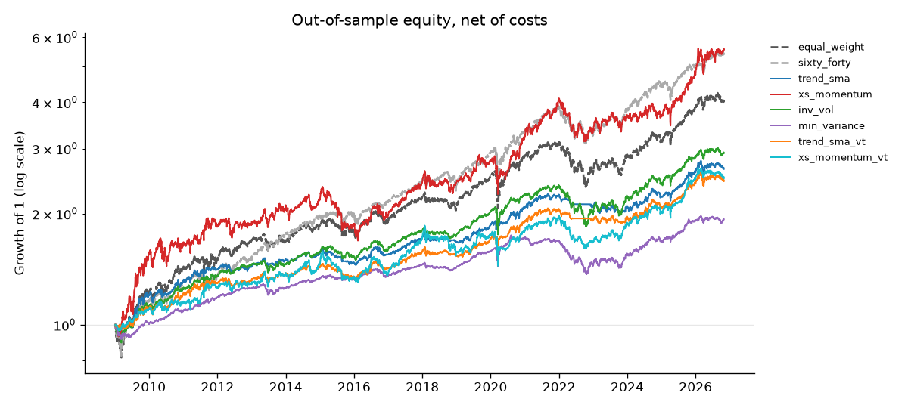

# Portfolio Backtester

A small, tested Python library and study that compares simple long-only strategies on seven liquid ETFs (US, international, and emerging equities, aggregate and long Treasury bonds, gold, and real estate). Parameters are chosen walk-forward, so every headline number is out-of-sample. Trades execute a day after the signal, weights drift between monthly rebalances, and every trade pays a cost. Results come with stationary bootstrap confidence intervals and a multiple-testing caveat. The goal is careful measurement, not a strategy that "works".

## Key results

<!-- RESULTS:START -->
*Generated by `make report` from `reports/real/`. Prices 2004-11-18 to 2026-10-30. Out-of-sample 2009-01-02 to 2026-10-30 (4485 trading days, 18 folds). 40 strategy-parameter combinations were tried, 720 fold evaluations in total.*

*Net of 5 bps per unit traded, lag 1 day(s), cash at 0.0% a year, monthly rebalancing. Sharpe intervals: 95% stationary bootstrap, 5000 resamples.*

| strategy | CAGR | Vol | Sharpe | Max DD | Turnover/yr | Sharpe 95% CI |
| --- | --- | --- | --- | --- | --- | --- |
| equal_weight | 8.1% | 11.4% | 0.74 | -24.6% | 19.1% | [0.29, 1.18] |
| sixty_forty | 9.9% | 10.7% | 0.94 | -21.5% | 13.3% | [0.48, 1.41] |
| trend_sma | 5.6% | 7.2% | 0.79 | -11.2% | 109.7% | [0.40, 1.18] |
| xs_momentum | 10.1% | 15.2% | 0.71 | -28.6% | 487.1% | [0.31, 1.11] |
| inv_vol | 6.2% | 7.6% | 0.83 | -22.6% | 55.2% | [0.35, 1.31] |
| min_variance | 3.8% | 5.3% | 0.73 | -21.5% | 64.1% | [0.25, 1.23] |
| trend_sma_vt | 5.2% | 6.7% | 0.78 | -9.2% | 114.0% | [0.39, 1.18] |
| xs_momentum_vt | 5.3% | 9.1% | 0.61 | -22.2% | 284.5% | [0.16, 1.09] |

Full tables and figures: [reports/real/report.md](reports/real/report.md).
<!-- RESULTS:END -->



## What the results show

- **Nothing clearly beat the simple benchmarks.** 60/40 had the highest Sharpe (0.94), and every paired Sharpe interval against equal weight and 60/40 includes zero. With 40 combinations tried, a small edge here is not evidence of a real one.
- **The real differences were in drawdowns.** Trend following cut the worst drawdown from -24.6% (equal weight) to -11.2%, or -9.2% with vol targeting, and lost 7.1% in 2022 versus 17.7% for equal weight. The price was lower growth: 5.6% CAGR versus 8.1%.
- **Momentum had the highest CAGR (10.1%) but paid for it.** It had the most volatility and turnover (about 487% a year), and it was the most sensitive to costs: its Sharpe fell from 0.74 at 0 bps to 0.58 at 25 bps.
- **Timing assumptions barely mattered.** Moving from a 1-day to a 2-day execution lag changed no Sharpe by more than 0.03.
- **Caveat:** the out-of-sample period starts in January 2009, right after the financial crisis, and is mostly a strong bull market that favours equity-heavy portfolios.

This block is written by `make report` from `reports/real/` only. A synthetic-data demo of the full pipeline lives in `reports/demo/` after `make demo`, and every number there is labeled DEMO.

## Method in brief

- **Universe:** SPY, EFA, EEM, AGG, TLT, GLD, VNQ, daily adjusted closes (total returns), common history from about Nov 2004.
- **Strategies:** equal weight and 60/40 benchmarks; trend following (price above its moving average); cross-sectional momentum with a one-month skip; inverse volatility; long-only minimum variance with a Ledoit-Wolf covariance; and a volatility-target overlay on trend and momentum.
- **Execution:** month-end signals, executed at the next day's close, holdings drift between rebalances, 5 bps per unit of traded notional, cash at 0%.
- **Selection:** expanding walk-forward. 36 months of training, then 12-month test blocks. In each fold the parameter set with the best in-sample net Sharpe is applied unchanged to the next block. The out-of-sample series is one continuous run, so switching costs are paid.
- **Statistics:** CAGR, volatility, Sharpe, Sortino, max drawdown, Calmar, turnover; 95% stationary bootstrap intervals (mean block 20 days, 5000 resamples) for each Sharpe and for paired differences versus both benchmarks; cost sensitivity at 0 to 25 bps; lag 1 versus 2; GFC, COVID, and 2022 subperiods.

Full definitions are in [docs/METHODS.md](docs/METHODS.md).

## How to run

```
make install   # editable install with dev and data extras
make data      # download prices into data/raw/ (needs internet; not committed)
make run && make report
```

`make check` runs lint and the 250+ tests offline. `make demo` runs the whole pipeline on synthetic data in about 15 seconds.

## Design decisions that matter most

- **No look-ahead, enforced by tests.** Every strategy and the engine are checked three ways for look-ahead, and a deliberately cheating "oracle" strategy must fail those checks, which proves they work ([tests/test_causality.py](tests/test_causality.py)).
- **One-day execution lag.** A signal from today's close cannot also trade at today's close. Lag 0 cannot even be configured.
- **Weights drift.** No hidden daily rebalancing between monthly trades.
- **Out-of-sample only.** Parameters are chosen with past data, and the chosen parameters never see the test year.
- **Honest uncertainty.** Paired bootstrap intervals show whether a strategy is distinguishable from a benchmark at all.

Every non-obvious choice, with the alternatives considered, is in [DECISIONS.md](DECISIONS.md). A guided tour and likely interview questions are in [docs/WALKTHROUGH.md](docs/WALKTHROUGH.md).

## Limitations

- **Hindsight in the universe.** These ETFs were chosen because they exist and are liquid today, so survivorship bias is possible.
- **Short sample.** About 20 years, with only a few distinct market regimes, and the out-of-sample period starts around the end of 2008, so the GFC window is too short of out-of-sample data to report and is left blank.
- **Multiple testing.** 40 strategy-parameter combinations are tried. The Deflated Sharpe Ratio is not implemented, so this bias is acknowledged but not corrected.
- **Simple frictions.** Costs are a flat rate on traded notional with a one or two day lag. No bid-ask spread model, no market impact, no taxes.
- **Cash earns 0%.** This understates cash-heavy strategies such as trend following when rates were high.

Educational project, not investment advice.

Built by David Goren and Claude Code.
