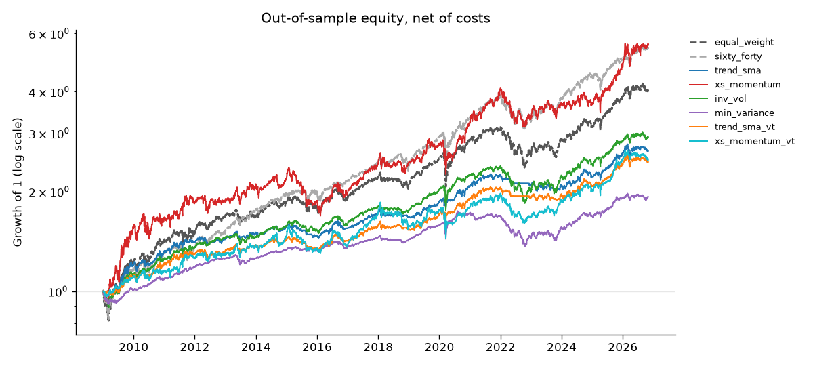
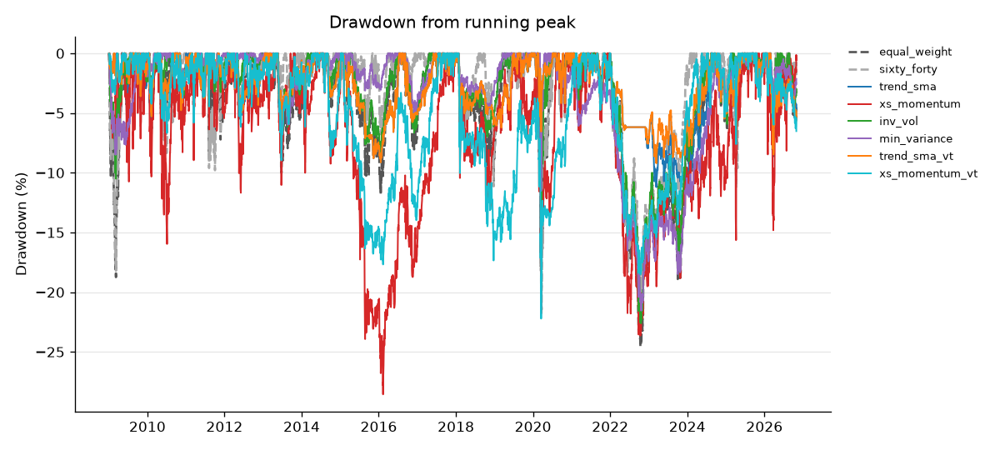
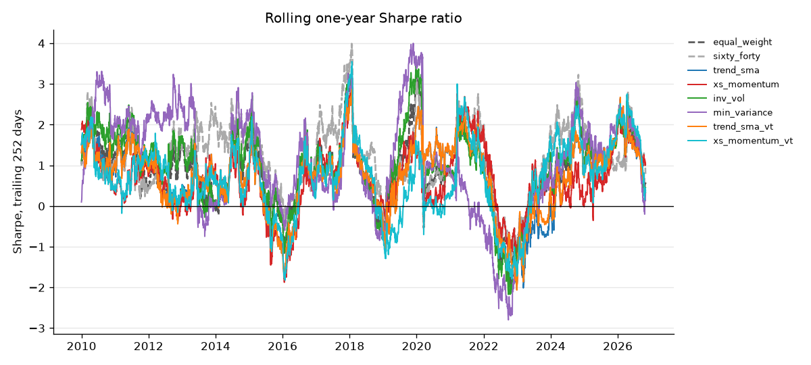
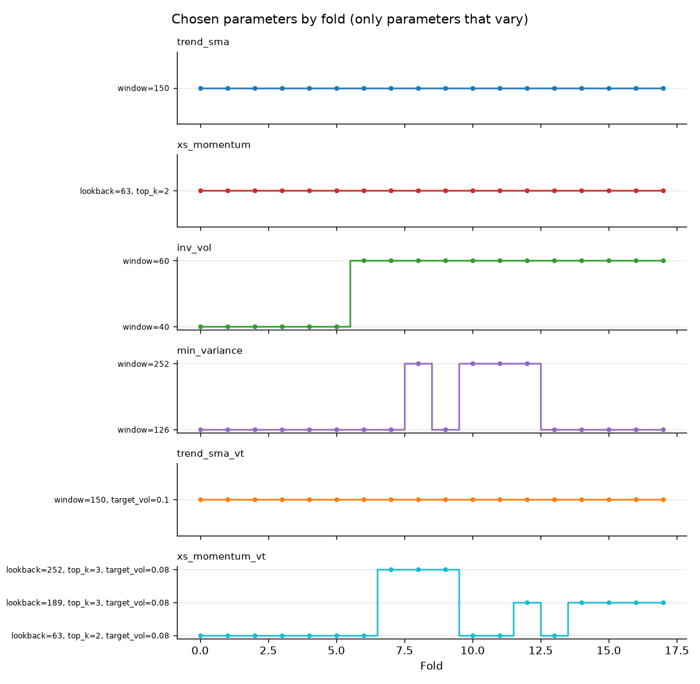
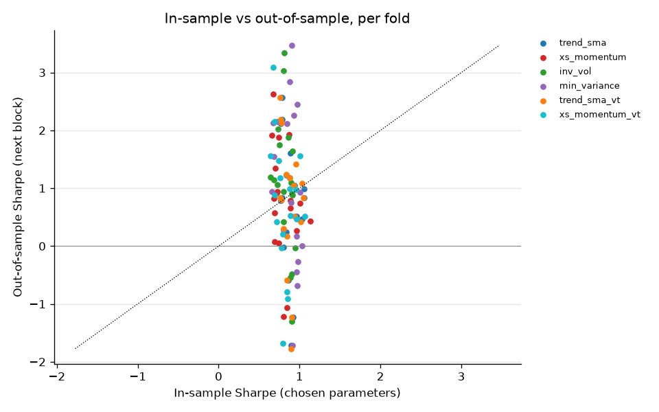
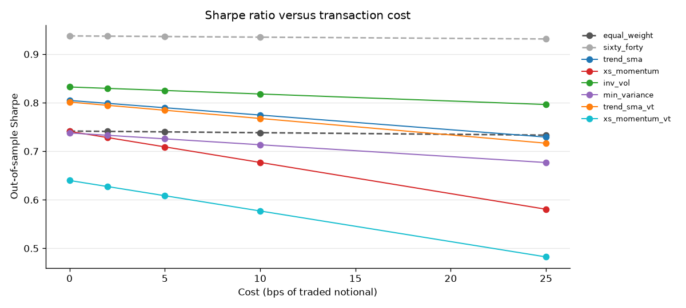
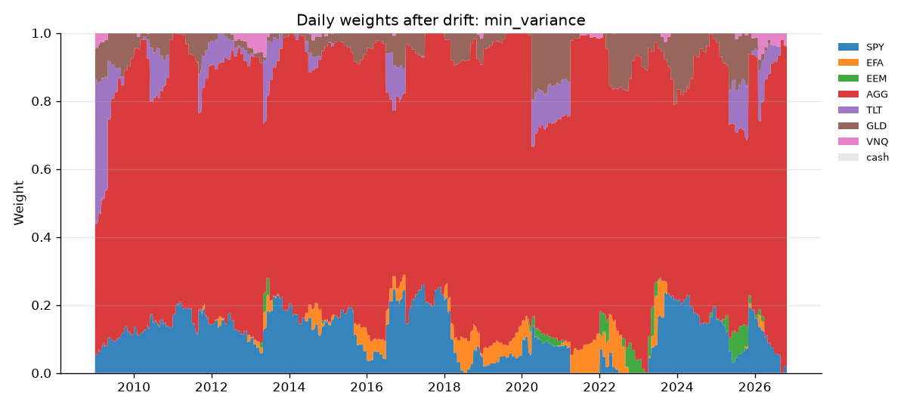
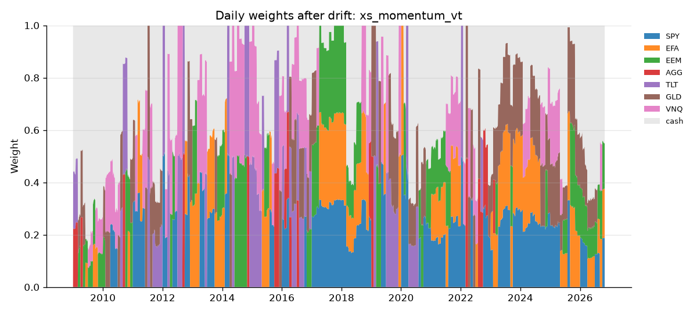

# Study report (real data)

Prices 2004-11-18 to 2026-10-30. Out-of-sample 2009-01-02 to 2026-10-30 (4485 trading days, 18 folds). 40 strategy-parameter combinations were tried, 720 fold evaluations in total.

Net of 5 bps per unit traded, lag 1 day(s), cash at 0.0% a year, monthly rebalancing. Sharpe intervals: 95% stationary bootstrap, 5000 resamples.

## Headline metrics (out-of-sample, net)

| strategy | CAGR | Vol | Sharpe | Sortino | Max DD | Calmar | Turnover/yr | Best month | Worst month | Skew | Excess kurt. |
| --- | --- | --- | --- | --- | --- | --- | --- | --- | --- | --- | --- |
| equal_weight | 8.1% | 11.4% | 0.74 | 1.05 | -24.6% | 0.33 | 19.1% | 8.5% | -8.7% | -0.29 | 8.21 |
| sixty_forty | 9.9% | 10.7% | 0.94 | 1.33 | -21.5% | 0.46 | 13.3% | 8.7% | -7.6% | -0.36 | 11.20 |
| trend_sma | 5.6% | 7.2% | 0.79 | 1.12 | -11.2% | 0.50 | 109.7% | 6.1% | -6.3% | -0.30 | 3.52 |
| xs_momentum | 10.1% | 15.2% | 0.71 | 1.00 | -28.6% | 0.35 | 487.1% | 12.8% | -10.2% | -0.28 | 3.58 |
| inv_vol | 6.2% | 7.6% | 0.83 | 1.17 | -22.6% | 0.27 | 55.2% | 7.7% | -7.3% | -0.45 | 10.16 |
| min_variance | 3.8% | 5.3% | 0.73 | 1.01 | -21.5% | 0.17 | 64.1% | 5.4% | -5.9% | -0.99 | 20.78 |
| trend_sma_vt | 5.2% | 6.7% | 0.78 | 1.10 | -9.2% | 0.56 | 114.0% | 4.6% | -6.3% | -0.34 | 3.07 |
| xs_momentum_vt | 5.3% | 9.1% | 0.61 | 0.84 | -22.2% | 0.24 | 284.5% | 8.2% | -6.4% | -0.57 | 6.46 |

## Sharpe ratio confidence intervals

| strategy | sharpe | ci_low | ci_high |
| --- | --- | --- | --- |
| equal_weight | 0.74 | 0.29 | 1.18 |
| sixty_forty | 0.94 | 0.48 | 1.41 |
| trend_sma | 0.79 | 0.40 | 1.18 |
| xs_momentum | 0.71 | 0.31 | 1.11 |
| inv_vol | 0.83 | 0.35 | 1.31 |
| min_variance | 0.73 | 0.25 | 1.23 |
| trend_sma_vt | 0.78 | 0.39 | 1.18 |
| xs_momentum_vt | 0.61 | 0.16 | 1.09 |

## Sharpe difference versus benchmarks (paired bootstrap)

An interval that contains 0 means the data cannot distinguish the strategy from the benchmark at this confidence level.

| strategy | versus | sharpe_diff | ci_low | ci_high | share_above_zero |
| --- | --- | --- | --- | --- | --- |
| equal_weight | sixty_forty | -0.20 | -0.43 | 0.02 | 3.9% |
| sixty_forty | equal_weight | 0.20 | -0.02 | 0.43 | 96.1% |
| trend_sma | equal_weight | 0.05 | -0.27 | 0.37 | 61.2% |
| trend_sma | sixty_forty | -0.15 | -0.56 | 0.24 | 23.2% |
| xs_momentum | equal_weight | -0.03 | -0.35 | 0.28 | 42.5% |
| xs_momentum | sixty_forty | -0.23 | -0.62 | 0.15 | 12.0% |
| inv_vol | equal_weight | 0.09 | -0.04 | 0.22 | 90.7% |
| inv_vol | sixty_forty | -0.11 | -0.40 | 0.17 | 22.2% |
| min_variance | equal_weight | -0.01 | -0.29 | 0.28 | 47.3% |
| min_variance | sixty_forty | -0.21 | -0.59 | 0.18 | 14.6% |
| trend_sma_vt | equal_weight | 0.04 | -0.27 | 0.37 | 60.5% |
| trend_sma_vt | sixty_forty | -0.15 | -0.56 | 0.23 | 22.8% |
| xs_momentum_vt | equal_weight | -0.13 | -0.45 | 0.19 | 22.2% |
| xs_momentum_vt | sixty_forty | -0.33 | -0.72 | 0.05 | 4.3% |

## Cost sensitivity (out-of-sample Sharpe)

| strategy | 0 bps | 2 bps | 5 bps | 10 bps | 25 bps |
| --- | --- | --- | --- | --- | --- |
| equal_weight | 0.74 | 0.74 | 0.74 | 0.74 | 0.73 |
| sixty_forty | 0.94 | 0.94 | 0.94 | 0.94 | 0.93 |
| trend_sma | 0.80 | 0.80 | 0.79 | 0.77 | 0.73 |
| xs_momentum | 0.74 | 0.73 | 0.71 | 0.68 | 0.58 |
| inv_vol | 0.83 | 0.83 | 0.83 | 0.82 | 0.80 |
| min_variance | 0.74 | 0.73 | 0.73 | 0.71 | 0.68 |
| trend_sma_vt | 0.80 | 0.79 | 0.78 | 0.77 | 0.72 |
| xs_momentum_vt | 0.64 | 0.63 | 0.61 | 0.58 | 0.48 |

## Execution lag sensitivity (out-of-sample Sharpe)

| strategy | lag 1 | lag 2 |
| --- | --- | --- |
| equal_weight | 0.74 | 0.74 |
| sixty_forty | 0.94 | 0.93 |
| trend_sma | 0.79 | 0.79 |
| xs_momentum | 0.71 | 0.74 |
| inv_vol | 0.83 | 0.83 |
| min_variance | 0.73 | 0.73 |
| trend_sma_vt | 0.78 | 0.78 |
| xs_momentum_vt | 0.61 | 0.64 |

## Subperiods (out-of-sample only)

oos_coverage is the share of the window inside the out-of-sample period. Windows below 90% coverage have no numbers on purpose: a partial window would show the wrong part of a crisis.

| subperiod | start | end | oos_coverage | strategy | status | total_return | max_drawdown |
| --- | --- | --- | --- | --- | --- | --- | --- |
| gfc | 2008-01-01 | 2009-06-30 | 31.7% | equal_weight | not reported: 32% out-of-sample | n/a | n/a |
| gfc | 2008-01-01 | 2009-06-30 | 31.7% | sixty_forty | not reported: 32% out-of-sample | n/a | n/a |
| gfc | 2008-01-01 | 2009-06-30 | 31.7% | trend_sma | not reported: 32% out-of-sample | n/a | n/a |
| gfc | 2008-01-01 | 2009-06-30 | 31.7% | xs_momentum | not reported: 32% out-of-sample | n/a | n/a |
| gfc | 2008-01-01 | 2009-06-30 | 31.7% | inv_vol | not reported: 32% out-of-sample | n/a | n/a |
| gfc | 2008-01-01 | 2009-06-30 | 31.7% | min_variance | not reported: 32% out-of-sample | n/a | n/a |
| gfc | 2008-01-01 | 2009-06-30 | 31.7% | trend_sma_vt | not reported: 32% out-of-sample | n/a | n/a |
| gfc | 2008-01-01 | 2009-06-30 | 31.7% | xs_momentum_vt | not reported: 32% out-of-sample | n/a | n/a |
| covid | 2020-02-01 | 2020-06-30 | 97.2% | equal_weight | reported | 0.6% | -20.8% |
| covid | 2020-02-01 | 2020-06-30 | 97.2% | sixty_forty | reported | 0.5% | -21.5% |
| covid | 2020-02-01 | 2020-06-30 | 97.2% | trend_sma | reported | 2.1% | -6.6% |
| covid | 2020-02-01 | 2020-06-30 | 97.2% | xs_momentum | reported | -4.2% | -21.2% |
| covid | 2020-02-01 | 2020-06-30 | 97.2% | inv_vol | reported | 2.9% | -15.9% |
| covid | 2020-02-01 | 2020-06-30 | 97.2% | min_variance | reported | 3.6% | -11.5% |
| covid | 2020-02-01 | 2020-06-30 | 97.2% | trend_sma_vt | reported | 2.0% | -6.6% |
| covid | 2020-02-01 | 2020-06-30 | 97.2% | xs_momentum_vt | reported | -6.2% | -19.2% |
| inflation_2022 | 2022-01-01 | 2022-12-31 | 96.5% | equal_weight | reported | -17.7% | -24.6% |
| inflation_2022 | 2022-01-01 | 2022-12-31 | 96.5% | sixty_forty | reported | -15.8% | -20.5% |
| inflation_2022 | 2022-01-01 | 2022-12-31 | 96.5% | trend_sma | reported | -7.1% | -7.6% |
| inflation_2022 | 2022-01-01 | 2022-12-31 | 96.5% | xs_momentum | reported | -18.4% | -23.6% |
| inflation_2022 | 2022-01-01 | 2022-12-31 | 96.5% | inv_vol | reported | -16.3% | -22.6% |
| inflation_2022 | 2022-01-01 | 2022-12-31 | 96.5% | min_variance | reported | -14.7% | -18.9% |
| inflation_2022 | 2022-01-01 | 2022-12-31 | 96.5% | trend_sma_vt | reported | -6.9% | -7.2% |
| inflation_2022 | 2022-01-01 | 2022-12-31 | 96.5% | xs_momentum_vt | reported | -15.0% | -18.5% |

## Chosen parameters per fold

| strategy | fold | train_end | test_end | params | is_sharpe | oos_sharpe |
| --- | --- | --- | --- | --- | --- | --- |
| equal_weight | 0.00 | 2008-12-31 | 2009-12-31 | - | 0.19 | 1.09 |
| equal_weight | 1.00 | 2009-12-31 | 2010-12-31 | - | 0.43 | 1.27 |
| equal_weight | 2.00 | 2010-12-31 | 2011-12-30 | - | 0.55 | 0.47 |
| equal_weight | 3.00 | 2011-12-30 | 2012-12-31 | - | 0.53 | 1.49 |
| equal_weight | 4.00 | 2012-12-31 | 2013-12-31 | - | 0.58 | -0.11 |
| equal_weight | 5.00 | 2013-12-31 | 2014-12-31 | - | 0.54 | 1.59 |
| equal_weight | 6.00 | 2014-12-31 | 2015-12-31 | - | 0.57 | -0.41 |
| equal_weight | 7.00 | 2015-12-31 | 2016-12-30 | - | 0.51 | 0.95 |
| equal_weight | 8.00 | 2016-12-30 | 2017-12-29 | - | 0.52 | 2.98 |
| equal_weight | 9.00 | 2017-12-29 | 2018-12-31 | - | 0.59 | -0.74 |
| equal_weight | 10.00 | 2018-12-31 | 2019-12-31 | - | 0.52 | 3.22 |
| equal_weight | 11.00 | 2019-12-31 | 2020-12-31 | - | 0.61 | 0.77 |
| equal_weight | 12.00 | 2020-12-31 | 2021-12-31 | - | 0.62 | 1.06 |
| equal_weight | 13.00 | 2021-12-31 | 2022-12-30 | - | 0.64 | -1.19 |
| equal_weight | 14.00 | 2022-12-30 | 2023-12-29 | - | 0.51 | 1.12 |
| equal_weight | 15.00 | 2023-12-29 | 2024-12-31 | - | 0.54 | 0.98 |
| equal_weight | 16.00 | 2024-12-31 | 2025-12-31 | - | 0.56 | 2.03 |
| equal_weight | 17.00 | 2025-12-31 | 2026-10-30 | - | 0.61 | 0.44 |
| sixty_forty | 0.00 | 2008-12-31 | 2009-12-31 | - | -0.11 | 1.06 |
| sixty_forty | 1.00 | 2009-12-31 | 2010-12-31 | - | 0.20 | 1.12 |
| sixty_forty | 2.00 | 2010-12-31 | 2011-12-30 | - | 0.33 | 0.43 |
| sixty_forty | 3.00 | 2011-12-30 | 2012-12-31 | - | 0.35 | 1.59 |
| sixty_forty | 4.00 | 2012-12-31 | 2013-12-31 | - | 0.43 | 2.11 |
| sixty_forty | 5.00 | 2013-12-31 | 2014-12-31 | - | 0.55 | 1.70 |
| sixty_forty | 6.00 | 2014-12-31 | 2015-12-31 | - | 0.60 | 0.08 |
| sixty_forty | 7.00 | 2015-12-31 | 2016-12-30 | - | 0.57 | 1.25 |
| sixty_forty | 8.00 | 2016-12-30 | 2017-12-29 | - | 0.60 | 3.42 |
| sixty_forty | 9.00 | 2017-12-29 | 2018-12-31 | - | 0.67 | -0.21 |
| sixty_forty | 10.00 | 2018-12-31 | 2019-12-31 | - | 0.61 | 2.87 |
| sixty_forty | 11.00 | 2019-12-31 | 2020-12-31 | - | 0.71 | 0.72 |
| sixty_forty | 12.00 | 2020-12-31 | 2021-12-31 | - | 0.70 | 2.00 |
| sixty_forty | 13.00 | 2021-12-31 | 2022-12-30 | - | 0.75 | -1.02 |
| sixty_forty | 14.00 | 2022-12-30 | 2023-12-29 | - | 0.61 | 1.84 |
| sixty_forty | 15.00 | 2023-12-29 | 2024-12-31 | - | 0.66 | 1.80 |
| sixty_forty | 16.00 | 2024-12-31 | 2025-12-31 | - | 0.70 | 1.16 |
| sixty_forty | 17.00 | 2025-12-31 | 2026-10-30 | - | 0.73 | 0.95 |
| trend_sma | 0.00 | 2008-12-31 | 2009-12-31 | window=150 | 0.88 | 1.60 |
| trend_sma | 1.00 | 2009-12-31 | 2010-12-31 | window=150 | 1.06 | 1.00 |
| trend_sma | 2.00 | 2010-12-31 | 2011-12-30 | window=150 | 1.06 | 0.83 |
| trend_sma | 3.00 | 2011-12-30 | 2012-12-31 | window=150 | 1.03 | 0.47 |
| trend_sma | 4.00 | 2012-12-31 | 2013-12-31 | window=150 | 0.96 | 0.52 |
| trend_sma | 5.00 | 2013-12-31 | 2014-12-31 | window=150 | 0.94 | 1.05 |
| trend_sma | 6.00 | 2014-12-31 | 2015-12-31 | window=150 | 0.92 | -1.22 |
| trend_sma | 7.00 | 2015-12-31 | 2016-12-30 | window=150 | 0.78 | 0.83 |
| trend_sma | 8.00 | 2016-12-30 | 2017-12-29 | window=150 | 0.78 | 2.57 |
| trend_sma | 9.00 | 2017-12-29 | 2018-12-31 | window=150 | 0.86 | -0.59 |
| trend_sma | 10.00 | 2018-12-31 | 2019-12-31 | window=150 | 0.78 | 2.19 |
| trend_sma | 11.00 | 2019-12-31 | 2020-12-31 | window=150 | 0.84 | 1.22 |
| trend_sma | 12.00 | 2020-12-31 | 2021-12-31 | window=150 | 0.88 | 1.18 |
| trend_sma | 13.00 | 2021-12-31 | 2022-12-30 | window=150 | 0.90 | -1.71 |
| trend_sma | 14.00 | 2022-12-30 | 2023-12-29 | window=150 | 0.80 | -0.02 |
| trend_sma | 15.00 | 2023-12-29 | 2024-12-31 | window=150 | 0.77 | 0.79 |
| trend_sma | 16.00 | 2024-12-31 | 2025-12-31 | window=150 | 0.77 | 2.12 |
| trend_sma | 17.00 | 2025-12-31 | 2026-10-30 | window=150 | 0.83 | 0.24 |
| xs_momentum | 0.00 | 2008-12-31 | 2009-12-31 | lookback=63,skip=21,top_k=2 | 0.87 | 1.93 |
| xs_momentum | 1.00 | 2009-12-31 | 2010-12-31 | lookback=63,skip=21,top_k=2 | 1.14 | 0.43 |
| xs_momentum | 2.00 | 2010-12-31 | 2011-12-30 | lookback=63,skip=21,top_k=2 | 1.01 | 0.74 |
| xs_momentum | 3.00 | 2011-12-30 | 2012-12-31 | lookback=63,skip=21,top_k=2 | 0.97 | 0.26 |
| xs_momentum | 4.00 | 2012-12-31 | 2013-12-31 | lookback=63,skip=21,top_k=2 | 0.89 | 0.65 |
| xs_momentum | 5.00 | 2013-12-31 | 2014-12-31 | lookback=63,skip=21,top_k=2 | 0.89 | 0.79 |
| xs_momentum | 6.00 | 2014-12-31 | 2015-12-31 | lookback=63,skip=21,top_k=2 | 0.85 | -1.07 |
| xs_momentum | 7.00 | 2015-12-31 | 2016-12-30 | lookback=63,skip=21,top_k=2 | 0.69 | 0.58 |
| xs_momentum | 8.00 | 2016-12-30 | 2017-12-29 | lookback=63,skip=21,top_k=2 | 0.68 | 2.63 |
| xs_momentum | 9.00 | 2017-12-29 | 2018-12-31 | lookback=63,skip=21,top_k=2 | 0.74 | 0.05 |
| xs_momentum | 10.00 | 2018-12-31 | 2019-12-31 | lookback=63,skip=21,top_k=2 | 0.70 | 1.34 |
| xs_momentum | 11.00 | 2019-12-31 | 2020-12-31 | lookback=63,skip=21,top_k=2 | 0.73 | 0.94 |
| xs_momentum | 12.00 | 2020-12-31 | 2021-12-31 | lookback=63,skip=21,top_k=2 | 0.74 | 1.88 |
| xs_momentum | 13.00 | 2021-12-31 | 2022-12-30 | lookback=63,skip=21,top_k=2 | 0.80 | -1.22 |
| xs_momentum | 14.00 | 2022-12-30 | 2023-12-29 | lookback=63,skip=21,top_k=2 | 0.68 | 0.82 |
| xs_momentum | 15.00 | 2023-12-29 | 2024-12-31 | lookback=63,skip=21,top_k=2 | 0.69 | 0.08 |
| xs_momentum | 16.00 | 2024-12-31 | 2025-12-31 | lookback=63,skip=21,top_k=2 | 0.66 | 1.91 |
| xs_momentum | 17.00 | 2025-12-31 | 2026-10-30 | lookback=63,skip=21,top_k=2 | 0.72 | 0.91 |
| inv_vol | 0.00 | 2008-12-31 | 2009-12-31 | window=40 | 0.64 | 1.19 |
| inv_vol | 1.00 | 2009-12-31 | 2010-12-31 | window=40 | 0.75 | 1.75 |
| inv_vol | 2.00 | 2010-12-31 | 2011-12-30 | window=40 | 0.90 | 1.09 |
| inv_vol | 3.00 | 2011-12-30 | 2012-12-31 | window=40 | 0.92 | 1.64 |
| inv_vol | 4.00 | 2012-12-31 | 2013-12-31 | window=40 | 0.95 | -0.03 |
| inv_vol | 5.00 | 2013-12-31 | 2014-12-31 | window=40 | 0.86 | 1.88 |
| inv_vol | 6.00 | 2014-12-31 | 2015-12-31 | window=60 | 0.91 | -0.49 |
| inv_vol | 7.00 | 2015-12-31 | 2016-12-30 | window=60 | 0.80 | 0.94 |
| inv_vol | 8.00 | 2016-12-30 | 2017-12-29 | window=60 | 0.80 | 3.03 |
| inv_vol | 9.00 | 2017-12-29 | 2018-12-31 | window=60 | 0.89 | -0.54 |
| inv_vol | 10.00 | 2018-12-31 | 2019-12-31 | window=60 | 0.81 | 3.34 |
| inv_vol | 11.00 | 2019-12-31 | 2020-12-31 | window=60 | 0.91 | 0.88 |
| inv_vol | 12.00 | 2020-12-31 | 2021-12-31 | window=60 | 0.90 | 0.91 |
| inv_vol | 13.00 | 2021-12-31 | 2022-12-30 | window=60 | 0.90 | -1.30 |
| inv_vol | 14.00 | 2022-12-30 | 2023-12-29 | window=60 | 0.69 | 1.14 |
| inv_vol | 15.00 | 2023-12-29 | 2024-12-31 | window=60 | 0.72 | 1.06 |
| inv_vol | 16.00 | 2024-12-31 | 2025-12-31 | window=60 | 0.74 | 2.02 |
| inv_vol | 17.00 | 2025-12-31 | 2026-10-30 | window=60 | 0.80 | 0.42 |
| min_variance | 0.00 | 2008-12-31 | 2009-12-31 | window=126 | 0.96 | 0.17 |
| min_variance | 1.00 | 2009-12-31 | 2010-12-31 | window=126 | 0.67 | 2.13 |
| min_variance | 2.00 | 2010-12-31 | 2011-12-30 | window=126 | 0.85 | 2.12 |
| min_variance | 3.00 | 2011-12-30 | 2012-12-31 | window=126 | 0.97 | 2.44 |
| min_variance | 4.00 | 2012-12-31 | 2013-12-31 | window=126 | 1.03 | 0.00 |
| min_variance | 5.00 | 2013-12-31 | 2014-12-31 | window=126 | 0.93 | 2.26 |
| min_variance | 6.00 | 2014-12-31 | 2015-12-31 | window=126 | 0.98 | -0.27 |
| min_variance | 7.00 | 2015-12-31 | 2016-12-30 | window=126 | 0.90 | 0.75 |
| min_variance | 8.00 | 2016-12-30 | 2017-12-29 | window=252 | 0.88 | 2.84 |
| min_variance | 9.00 | 2017-12-29 | 2018-12-31 | window=126 | 0.96 | -0.45 |
| min_variance | 10.00 | 2018-12-31 | 2019-12-31 | window=252 | 0.90 | 3.47 |
| min_variance | 11.00 | 2019-12-31 | 2020-12-31 | window=252 | 1.01 | 0.93 |
| min_variance | 12.00 | 2020-12-31 | 2021-12-31 | window=252 | 0.97 | -0.68 |
| min_variance | 13.00 | 2021-12-31 | 2022-12-30 | window=126 | 0.91 | -1.72 |
| min_variance | 14.00 | 2022-12-30 | 2023-12-29 | window=126 | 0.65 | 0.94 |
| min_variance | 15.00 | 2023-12-29 | 2024-12-31 | window=126 | 0.68 | 1.55 |
| min_variance | 16.00 | 2024-12-31 | 2025-12-31 | window=126 | 0.72 | 2.15 |
| min_variance | 17.00 | 2025-12-31 | 2026-10-30 | window=126 | 0.80 | 0.28 |
| trend_sma_vt | 0.00 | 2008-12-31 | 2009-12-31 | cov_window=60,target_vol=0.1,window=150 | 0.96 | 1.41 |
| trend_sma_vt | 1.00 | 2009-12-31 | 2010-12-31 | cov_window=60,target_vol=0.1,window=150 | 1.03 | 1.08 |
| trend_sma_vt | 2.00 | 2010-12-31 | 2011-12-30 | cov_window=60,target_vol=0.1,window=150 | 1.05 | 0.84 |
| trend_sma_vt | 3.00 | 2011-12-30 | 2012-12-31 | cov_window=60,target_vol=0.1,window=150 | 1.02 | 0.42 |
| trend_sma_vt | 4.00 | 2012-12-31 | 2013-12-31 | cov_window=60,target_vol=0.1,window=150 | 0.94 | 0.52 |
| trend_sma_vt | 5.00 | 2013-12-31 | 2014-12-31 | cov_window=60,target_vol=0.1,window=150 | 0.93 | 1.05 |
| trend_sma_vt | 6.00 | 2014-12-31 | 2015-12-31 | cov_window=60,target_vol=0.1,window=150 | 0.90 | -1.22 |
| trend_sma_vt | 7.00 | 2015-12-31 | 2016-12-30 | cov_window=60,target_vol=0.1,window=150 | 0.76 | 0.83 |
| trend_sma_vt | 8.00 | 2016-12-30 | 2017-12-29 | cov_window=60,target_vol=0.1,window=150 | 0.76 | 2.57 |
| trend_sma_vt | 9.00 | 2017-12-29 | 2018-12-31 | cov_window=60,target_vol=0.1,window=150 | 0.85 | -0.59 |
| trend_sma_vt | 10.00 | 2018-12-31 | 2019-12-31 | cov_window=60,target_vol=0.1,window=150 | 0.77 | 2.19 |
| trend_sma_vt | 11.00 | 2019-12-31 | 2020-12-31 | cov_window=60,target_vol=0.1,window=150 | 0.83 | 1.24 |
| trend_sma_vt | 12.00 | 2020-12-31 | 2021-12-31 | cov_window=60,target_vol=0.1,window=150 | 0.88 | 1.18 |
| trend_sma_vt | 13.00 | 2021-12-31 | 2022-12-30 | cov_window=60,target_vol=0.1,window=150 | 0.89 | -1.77 |
| trend_sma_vt | 14.00 | 2022-12-30 | 2023-12-29 | cov_window=60,target_vol=0.1,window=150 | 0.80 | 0.30 |
| trend_sma_vt | 15.00 | 2023-12-29 | 2024-12-31 | cov_window=60,target_vol=0.1,window=150 | 0.78 | 0.80 |
| trend_sma_vt | 16.00 | 2024-12-31 | 2025-12-31 | cov_window=60,target_vol=0.1,window=150 | 0.78 | 2.13 |
| trend_sma_vt | 17.00 | 2025-12-31 | 2026-10-30 | cov_window=60,target_vol=0.1,window=150 | 0.84 | 0.17 |
| xs_momentum_vt | 0.00 | 2008-12-31 | 2009-12-31 | cov_window=60,lookback=63,skip=21,target_vol=0.08,top_k=2 | 1.00 | 1.56 |
| xs_momentum_vt | 1.00 | 2009-12-31 | 2010-12-31 | cov_window=60,lookback=63,skip=21,target_vol=0.08,top_k=2 | 1.06 | 0.52 |
| xs_momentum_vt | 2.00 | 2010-12-31 | 2011-12-30 | cov_window=60,lookback=63,skip=21,target_vol=0.08,top_k=2 | 0.96 | 0.98 |
| xs_momentum_vt | 3.00 | 2011-12-30 | 2012-12-31 | cov_window=60,lookback=63,skip=21,target_vol=0.08,top_k=2 | 0.96 | 0.46 |
| xs_momentum_vt | 4.00 | 2012-12-31 | 2013-12-31 | cov_window=60,lookback=63,skip=21,target_vol=0.08,top_k=2 | 0.89 | 0.52 |
| xs_momentum_vt | 5.00 | 2013-12-31 | 2014-12-31 | cov_window=60,lookback=63,skip=21,target_vol=0.08,top_k=2 | 0.88 | 0.99 |
| xs_momentum_vt | 6.00 | 2014-12-31 | 2015-12-31 | cov_window=60,lookback=63,skip=21,target_vol=0.08,top_k=2 | 0.85 | -0.91 |
| xs_momentum_vt | 7.00 | 2015-12-31 | 2016-12-30 | cov_window=60,lookback=252,skip=21,target_vol=0.08,top_k=3 | 0.72 | 0.42 |
| xs_momentum_vt | 8.00 | 2016-12-30 | 2017-12-29 | cov_window=60,lookback=252,skip=21,target_vol=0.08,top_k=3 | 0.68 | 3.09 |
| xs_momentum_vt | 9.00 | 2017-12-29 | 2018-12-31 | cov_window=60,lookback=252,skip=21,target_vol=0.08,top_k=3 | 0.85 | -0.79 |
| xs_momentum_vt | 10.00 | 2018-12-31 | 2019-12-31 | cov_window=60,lookback=63,skip=21,target_vol=0.08,top_k=2 | 0.74 | 1.48 |
| xs_momentum_vt | 11.00 | 2019-12-31 | 2020-12-31 | cov_window=60,lookback=63,skip=21,target_vol=0.08,top_k=2 | 0.79 | 0.21 |
| xs_momentum_vt | 12.00 | 2020-12-31 | 2021-12-31 | cov_window=60,lookback=189,skip=21,target_vol=0.08,top_k=3 | 0.76 | 1.17 |
| xs_momentum_vt | 13.00 | 2021-12-31 | 2022-12-30 | cov_window=60,lookback=63,skip=21,target_vol=0.08,top_k=2 | 0.79 | -1.68 |
| xs_momentum_vt | 14.00 | 2022-12-30 | 2023-12-29 | cov_window=60,lookback=189,skip=21,target_vol=0.08,top_k=3 | 0.64 | 1.56 |
| xs_momentum_vt | 15.00 | 2023-12-29 | 2024-12-31 | cov_window=60,lookback=189,skip=21,target_vol=0.08,top_k=3 | 0.69 | 0.88 |
| xs_momentum_vt | 16.00 | 2024-12-31 | 2025-12-31 | cov_window=60,lookback=189,skip=21,target_vol=0.08,top_k=3 | 0.69 | 2.15 |
| xs_momentum_vt | 17.00 | 2025-12-31 | 2026-10-30 | cov_window=60,lookback=189,skip=21,target_vol=0.08,top_k=3 | 0.77 | -0.03 |

## Data coverage

| ticker | first_date | last_date | rows |
| --- | --- | --- | --- |
| SPY | 2004-01-02 | 2026-10-30 | 5744.00 |
| EFA | 2004-01-02 | 2026-10-30 | 5744.00 |
| EEM | 2004-01-02 | 2026-10-30 | 5744.00 |
| AGG | 2004-01-02 | 2026-10-30 | 5744.00 |
| TLT | 2004-01-02 | 2026-10-30 | 5744.00 |
| GLD | 2004-11-18 | 2026-10-30 | 5522.00 |
| VNQ | 2004-09-29 | 2026-10-30 | 5558.00 |

## Multiple testing

40 strategy-parameter combinations were evaluated. The best of many tries looks better than it is by chance alone. The Deflated Sharpe Ratio is not implemented, so this bias is acknowledged but not corrected.

## Figures

Educational project, not investment advice.
